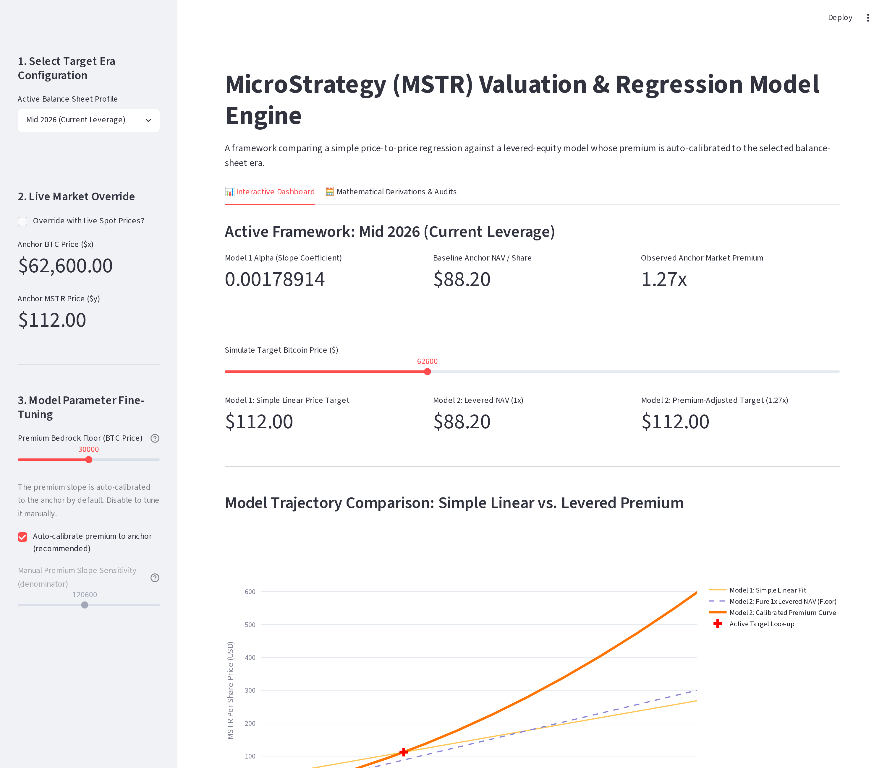

# when mstr will fkup

A small Streamlit app that plays with how the **MicroStrategy (MSTR)** share
price tracks the **Bitcoin (BTC)** spot price. It compares a naive
price-to-price line against a levered net-asset-value model whose premium is
calibrated to a chosen balance-sheet era.

Educational toy, not investment advice. The numbers are illustrative snapshots
and may be out of date.



## Run it

```bash
python -m pip install -r requirements.txt
python -m streamlit run main.py
```

Opens at http://localhost:8501.

## Models

- **Model 1** — a plain proportional line, `MSTR = alpha * BTC`.
- **Model 2** — levered NAV per share times a premium that's auto-calibrated to
  reproduce the era's anchor exactly.

The "Mathematical Derivations" tab in the app walks through the full
derivation and shows a live calibration check.

## Files

- `main.py` — the whole app
- `requirements.txt` — dependencies
